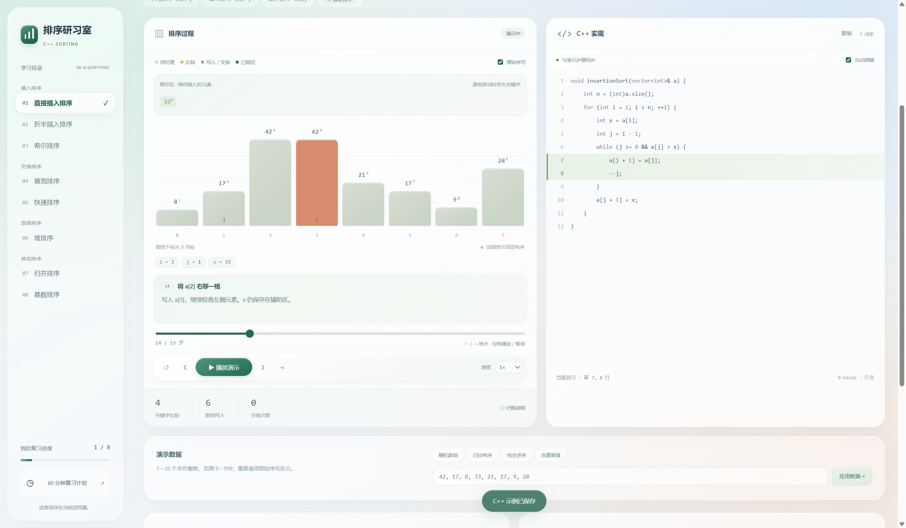

# 排序研习室

用柱状图、逐步演示和 C++ 代码高亮复习八种排序。提供离线网页、Windows 桌面版和安卓安装包。



## 下载

[打开 v1.0.0 下载页](https://github.com/PeiyangFantasist/sorting-study/releases/tag/v1.0.0)

| 文件 | 使用方式 |
| --- | --- |
| `sorting-review.html` | 下载后双击，用浏览器离线打开 |
| `SortingStudy.exe` | Windows 10 / 11，64 位；双击运行，需 WebView2 Runtime 和 .NET Framework 4.6.2 或更新版本 |
| `SortingStudy-android.apk` | Android 8.0 或以上，下载后安装 |
| `SortingStudy-1.0.0.zip` | 源码、上述三个版本及使用说明的整包 |
| `SHA256SUMS.txt` | 下载文件的 SHA-256 校验值 |

仓库为私有时，需登录有访问权限的 GitHub 账号才能下载。

## 可以做什么

- 直接插入、折半插入、希尔、冒泡、快速、堆、归并、基数排序。
- 播放、暂停、单步、回退、变速和拖动进度，当前操作同步高亮 C++ 代码。
- 观察堆的完全二叉树、归并辅助数组、基数桶和插入时的暂存元素。
- 输入 3–20 个 0–999 的整数，或使用随机、有序、逆序、含重复值的数据。
- 用元素的原始序号观察稳定性，复制或保存带 `main()` 的 C++17 示例。
- 查看算法对照、完成 16 道自测，保存本机的掌握标记和答题记录。

界面使用半透明导航、圆角按钮和浅色内容区。图表和代码保留清楚的颜色与对比度。离线导出保留了完整颜色变量，已修复播放时柱子变透明的问题。

键盘：左右方向键单步，Home / End 跳到开始 / 结果，空格播放 / 暂停。焦点在输入框或按钮上时，空格保留控件本身的行为。Windows 版支持 F11 全屏。

## 实现约定

数组下标从 0 开始，按升序排列。快排使用末元素作轴的 Lomuto 划分（严格 `<`），希尔排序采用折半增量，基数排序固定处理个位、十位、百位。这些版本与课堂代码可能存在实现差别。

复习记录保存在当前浏览器或应用的本地存储里，网页、Windows 和安卓之间不会自动同步。安卓版本没有申请网络、相机、位置或存储权限；保存 C++ 文件时使用系统文件保存窗口。

## 源码

```text
web/       网页、算法轨迹、C++ 示例、自测与样式
scripts/   离线网页导出与颜色回归检查
tests/     八种算法的结果、稳定性、计数与逐帧检查
desktop/   Windows 程序、WebView2 包装与构建说明
android/   Android WebView 应用、资源与构建说明
docs/      界面截图、使用说明、验证记录
release/   本地导出目录（构建产物不提交到 Git）
```

打开 `web/index.html` 可查看分文件网页；该页面字体可从 Google Fonts 加载。导出的单文件 HTML 和两个应用使用本机字体，复习功能不需要联网。

导出离线网页（需要 Node.js 18 或更新版本，无 npm 依赖）：

```sh
node scripts/export-offline.cjs
```

算法检查与安卓桥接检查：

```sh
node tests/verify-all.cjs
node android/tests/bridge.cjs
```

检查离线导出保留的颜色：

```sh
python -m pip install -r requirements-dev.txt
python scripts/verify-offline-css.py
```

原生应用构建步骤见 [Windows 说明](desktop/README.md) 和 [Android 说明](android/README.md)。安卓签名私钥与密码保留在本机，不包含在仓库和下载整包中。自行构建签名版本时需使用自己的签名密钥。

## 验证情况

算法检查覆盖 4,200 组输入，检查每一帧的有效下标、代码行号、计数和排序区域。Windows 版已在本机实际启动并检查播放、柱状图颜色、C++ 导出及重开后的记录保存。

安卓 APK 已通过编译、签名、对齐、资源与桥接检查，尚未在安卓真机或模拟器上运行。详见 [验证记录](docs/validation.md)。
